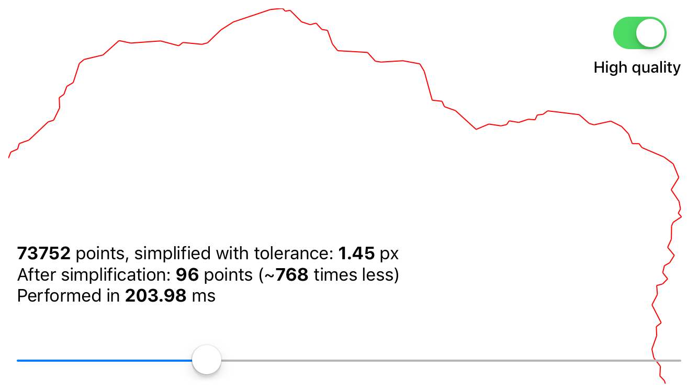

# SimplifySwift

[](LICENSE)

SimplifySwift is a high-performance Swift polyline simplification library ported from [Simplify.js](http://mourner.github.io/simplify-js/). The original Javascript library was extracted from [Leaflet](https://leafletjs.com), a JS interactive maps library by [Vladimir Agafonkin](http://agafonkin.com/en). It uses a combination of Douglas-Peucker and Radial Distance algorithms.

Polyline simplification dramatically reduces the number of points in a polyline while retaining its shape, giving a huge performance boost when processing it and also reducing visual noise. For example, it's essential when rendering a large polyline in MapKit.



## Example

To run the example project, clone the repo and open:

`Example/Simplify-Swift.xcodeproj`

## Installation

### Swift Package Manager (SPM)

To integrate using Apple's Swift package manager, add the following as a dependency to your Package.swift:

```
.package(url: "https://github.com/tomislav/Simplify-Swift.git", .upToNextMajor(from: "1.0.0"))
```

## Usage

```swift
class func simplify<T:SimplifyValue>(_ points: [T], tolerance: Double = 1, highQuality: Bool = false) -> [T]
```

Returns an array of simplified points

- parameter `points`:      An array of points of `SimplifyValue {x: Double, y: Double}` format. Generics are supported so you can pass in an array of `[CGPoint]` or `[CLLocationCoordinate2D]`.
- parameter `tolerance`:   Affects the amount of simplification (in the same metric as the point coordinates). Default: `1`.
- parameter `highQuality`: Excludes distance-based preprocessing step which leads to highest quality simplification but runs ~10-20 times slower. Default: false.

## Author

Tomislav Filipcic, tf@7sols.com, [@tomislav](https://twitter.com/tomislav)

## License

SimplifySwift is available under the MIT license. See the LICENSE file for more info.
